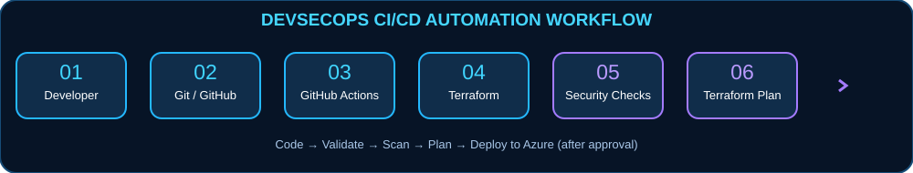
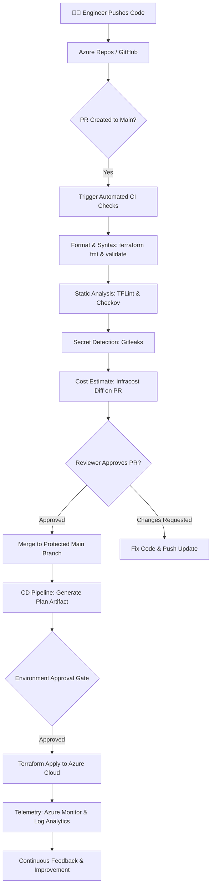

<!-- Custom GitHub-safe SVG artwork lives in /assets. -->
<div align="center">


<a href="https://github.com/achikhussain12"></a>
<a href="https://www.linkedin.com/in/achik-hussain"></a>
<a href="mailto:hussainachik456@gmail.com"></a>


### Junior DevOps & Cloud Infrastructure Engineer

**Assam, India** · **Diploma in Computer Science & Engineering** · **Azure | Terraform | Automated CI/CD**

**📧 [hussainachik456@gmail.com](mailto:hussainachik456@gmail.com)** &nbsp; | &nbsp; **📱 +91 8724872091**

**💼 [LinkedIn](https://www.linkedin.com/in/achik-hussain)** &nbsp; | &nbsp; **💻 [GitHub](https://github.com/achikhussain12)**

<a href="tel:+918724872091"></a>

<sub>☁️ CLOUD INFRASTRUCTURE &nbsp; • &nbsp; ⚙️ AUTOMATION FIRST &nbsp; • &nbsp; 🛡️ RELIABILITY BY DESIGN</sub>

</div>

---

### 🧭 Profile Navigation

<div align="center">
<a href="#-about-me">About Me</a> &nbsp;•&nbsp;
<a href="#️-technical-arsenal">Tech Arsenal</a> &nbsp;•&nbsp;
<a href="#-hands-on-devops-case-studies">Case Studies</a> &nbsp;•&nbsp;
<a href="#-operational-debugging-runbooks">Ops Runbooks</a> &nbsp;•&nbsp;
<a href="#-cloud--devops-engineering-playbook">Playbook</a> &nbsp;•&nbsp;
<a href="#-github-analytics">Analytics</a>
</div>

---

## 👨‍💻 About Me

<div align="center">

<!-- AUTOMATION PHILOSOPHY ANIMATION -->


<p><b>Bridging Developer Agility with Automated, Observable &amp; Cost-Effective Cloud Infrastructure.</b></p>

```zsh
achik@azure-cloud:~$ cat /etc/profile.d/devops.env
```

```yaml
ENGINEER:      "Achik Hussain"
LOCATION:      "Assam, India 🇮🇳"
EDUCATION:     "Diploma in Computer Science & Engineering"
ROLE:          "Junior DevOps & Cloud Infrastructure Engineer"
PRIMARY_STACK: ["Microsoft Azure", "Terraform (IaC)", "Azure DevOps Pipelines", "Linux / Bash"]
AUTOMATION:    ["YAML Pipelines", "GitHub Actions", "Infracost (FinOps)", "Checkov", "Gitleaks"]
CORE_MOTTO:    "If you configure it manually once, automate it in code the second time."
STATUS:        "🟢 Actively Building Real Cloud Labs & Ready for Junior DevOps Opportunities"
```

</div>

<table>
<tr>
<td width="58%" valign="top">

### 👋 Hello, I’m Achik

I am a **Diploma in Computer Science & Engineering** student from **Assam, India**, dedicated to mastering **Microsoft Azure, Infrastructure as Code (IaC), and automated CI/CD engineering**.

I enjoy building hands-on cloud architectures: provisioning isolated, secure networks with **modular Terraform**, automating release workflows with **Azure DevOps multi-stage YAML pipelines**, and shifting **pre-commit linting, security scans, and cost checks** earlier into the deployment lifecycle.

My engineering philosophy is simple: **if it's repeatable, automate it; if it's infrastructure, version-control it.** I document my lab experiments, test every plan prior to applying, and continually hone my cloud engineering skills.

**🎯 Daily Engineering Focus:**
- ☁️ **Azure Cloud & Networking:** Resource Groups, VNets, Subnets, NSGs, Storage Accounts, and Managed Identities.
- 🏗️ **Terraform Modules & State:** Reusable environment structure, remote state locking in Azure Blob Storage, and drift detection.
- 🔁 **CI/CD Pipeline Automation:** Multi-stage YAML workflows, pull-request validations, and gated deployment approvals.
- 🔐 **Pre-Flight Guardrails:** Secret scanning with `Gitleaks`, IaC linting with `TFLint`, and misconfiguration checks with `Checkov`.
- 💸 **FinOps Awareness:** Proactive cloud cost estimation using `Infracost` directly inside pull requests.

</td>
<td width="42%" valign="top">

### ⚡ At a Glance

| Attribute | Details |
|:--|:--|
| 📍 **Base** | Assam, India |
| 🎓 **Education** | Diploma in Computer Science |
| ☁️ **Cloud** | Microsoft Azure |
| 🧱 **IaC** | Terraform (HCL) |
| 🔁 **CI/CD** | Azure DevOps · GitHub Actions |
| 📊 **Monitoring** | Azure Monitor · Log Analytics (KQL) |
| 🐧 **Systems** | Linux (Ubuntu/RHEL) · Bash · PowerShell |
| 🌱 **Mode** | Always Learning & Automating |

<div align="center">

<br/>

**Automated Delivery Loop**  
`PLAN` ➔ `LINT` ➔ `SCAN` ➔ `COST CHECK` ➔ `APPROVE` ➔ `APPLY`

</div>

</td>
</tr>
</table>

<div align="center">

<a href="mailto:hussainachik456@gmail.com"></a>
<a href="https://www.linkedin.com/in/achik-hussain"></a>

*“Learn deeply. Automate thoughtfully. Build reliably.”*

</div>

---

## 🛠️ Technical Arsenal

<div align="center">

### ☁️ Cloud Platforms & Infrastructure as Code


<br/>


### 🔁 Version Control, CI/CD & Delivery


<br/>


### 📊 Observability, Security Scanning & FinOps


### 💻 Programming & Database Fundamentals


</div>

---

## 🚀 Hands-On DevOps Case Studies

<div align="center">

</div>

> *Practical engineering scenarios designed and implemented to mirror production cloud operations.*

<table>
<tr>
<td width="50%" valign="top">

### ☁️ Case Study 01: Multi-Environment Azure IaC with Terraform
**Stack:** `Azure` · `Terraform` · `Azure Blob Backend` · `State Locking`

**The Challenge:**  
Manual cloud resource creation in the Azure Portal leads to environment drift, untracked changes, and potential concurrent writes during team collaboration.

**Architecture & Solution:**  
- Built reusable root and child Terraform modules for VNets, Subnets, and NSGs.
- Configured a dedicated Azure Storage Account container with Blob lease locking to prevent race conditions during concurrent runs.
- Structured isolated workspace environments (`dev`, `stage`, `prod`) using parameterized `terraform.tfvars`.

**Result & Impact:**  
Zero manual console clicks, 100% reproducible environments, and instant visibility into drift using `terraform plan -detailed-exitcode`.

</td>
<td width="50%" valign="top">

### 🔁 Case Study 02: Multi-Stage Azure DevOps CI/CD Pipeline
**Stack:** `Azure DevOps YAML` · `Azure Repos` · `Service Connections` · `Gated Approvals`

**The Challenge:**  
Ensuring that infrastructure code changes are validated, linted, and reviewed for cost impact prior to being applied to live Azure subscriptions.

**Architecture & Solution:**  
- Designed a multi-stage YAML pipeline triggered on pull requests.
- **Stage 1 (Validation):** Runs `terraform fmt -check`, `tflint`, and `terraform validate`.
- **Stage 2 (Inspection):** Scans for hardcoded secrets with `Gitleaks` and generates plan artifacts.
- **Stage 3 (Production Gate):** Protected deployment job requiring manual human sign-off before executing `terraform apply`.

**Result & Impact:**  
Protected the `main` branch from broken code, ensuring that all production changes are auditable and reviewed.

</td>
</tr>
<tr>
<td width="50%" valign="top">

### 💸 Case Study 03: Proactive FinOps & Policy Guardrails
**Stack:** `Infracost` · `Checkov` · `GitHub Actions` · `PR Comments`

**The Challenge:**  
Unexpected cloud bills caused by oversized VM SKUs or unbudgeted provisioning, discovered only after monthly invoicing.

**Architecture & Solution:**  
- Integrated `Infracost` into pull-request CI checks to parse Terraform diffs.
- Automated PR comment generation detailing monthly cost differences before code merge.
- Enforced baseline IaC policies with `Checkov` to block wide-open `0.0.0.0/0` inbound rules.

**Result & Impact:**  
Total cost visibility for engineering leads during code review, preventing expensive misconfigurations before resource creation.

</td>
<td width="50%" valign="top">

### 📊 Case Study 04: Centralized Cloud Health with Azure Monitor
**Stack:** `Azure Log Analytics` · `KQL Queries` · `Action Groups` · `Alerts`

**The Challenge:**  
Detecting virtual machine CPU/Memory bottlenecks and failed automated pipeline runs before end users experience degradation.

**Architecture & Solution:**  
- Deployed centralized Log Analytics Workspace with diagnostic settings.
- Wrote custom Kusto Query Language (KQL) scripts to identify threshold spikes.
- Configured Action Groups routing alert notifications to email and incident channels.

**Result & Impact:**  
Fast mean-time-to-detection (MTTD) for cloud infrastructure anomalies and automated pipeline telemetry.

</td>
</tr>
</table>

---

## 🧭 How I Think About DevOps & CI/CD Delivery



<div align="center">

**`PLAN` ➔ `VALIDATE` ➔ `ESTIMATE COST` ➔ `APPROVE` ➔ `APPLY` ➔ `MONITOR`**

</div>

---

## ⚡ Operational Debugging Runbooks (Junior DevOps Scenarios)

> *Real-world troubleshooting workflows demonstrating how I diagnose and resolve common cloud infrastructure incidents.*

<details>
<summary><b>🛠️ Runbook 01: Terraform State Locked (LeaseAlreadyPresent Error)</b></summary>

### Problem Symptom:
`Error: Error acquiring the state lock: Storage: state blob is already leased.`

### Step-by-Step Triage:
1. **Check for Running Pipelines:** Verify if another colleague or automated Azure DevOps pipeline is actively running `terraform apply`.
2. **Inspect the Azure Storage Blob:** Navigate to Azure Portal ➔ Storage Account ➔ Container (`tfstate`) ➔ Inspect blob lease status (`Leased` vs `Available`).
3. **Validate Writer Deadlock:** If the previous pipeline crashed midway, note the `Lock Info` ID from the CLI error output.
4. **Safe Resolution:**
   ```bash
   # Run only after verifying that NO active pipeline is writing to state
   terraform force-unlock <LOCK-ID>
   ```
5. **Post-Incident Action:** Review pipeline timeout settings to prevent aborted builds from leaving unreleased locks.

</details>

<details>
<summary><b>🔐 Runbook 02: Azure Service Principal RBAC AuthorizationFailed (HTTP 403)</b></summary>

### Problem Symptom:
`AuthorizationFailed: Client with object id 'xxx' does not have authorization to perform action 'Microsoft.Resources/subscriptions/resourceGroups/write' over scope...`

### Step-by-Step Triage:
1. **Identify the Acting Identity:** Run `az account show` to check whether the pipeline is running under a Service Principal, Managed Identity, or User account.
2. **Inspect Role Assignments:**
   ```bash
   az role assignment list --assignee <CLIENT-ID> --output table
   ```
3. **Verify Scope Boundary:** Check if the role (e.g., `Contributor`) is assigned at the Resource Group level when the Terraform code attempts to create a Subscription-level resource (e.g., Resource Group creation itself).
4. **Resolution:** Elevate or adjust the RBAC assignment to the appropriate scope boundary following the **Principle of Least Privilege**.

</details>

<details>
<summary><b>⚙️ Runbook 03: Azure DevOps YAML Pipeline Template Not Found</b></summary>

### Problem Symptom:
`Could not find template file: /pipelines/templates/terraform-plan.yml in repository self.`

### Step-by-Step Triage:
1. **Verify Relative vs Absolute Path:** Review the `template:` keyword syntax (`templates/step.yml` vs `/templates/step.yml`).
2. **Check Git Case Sensitivity:** Windows filesystems are case-insensitive, but Linux build agents (`ubuntu-latest`) fail on `Terraform-plan.yml` vs `terraform-plan.yml`.
3. **Branch Context:** Ensure the referenced template file is committed and pushed to the exact branch triggering the pipeline run.

</details>

<details>
<summary><b>📊 Runbook 04: KQL (Kusto Query Language) Essentials for Log Analytics</b></summary>

### Essential KQL Queries for Cloud Diagnostics:

**Query 1: Detect Failed Administrative Activity in Azure**
```kql
AzureActivity
| where TimeGenerated > ago(24h)
| where ActivityStatusValue == "Failed"
| project TimeGenerated, Caller, OperationNameValue, ResourceGroup, ActivityStatusValue
| order by TimeGenerated desc
```

**Query 2: Virtual Machine High CPU Utilization Warning**
```kql
Perf
| where TimeGenerated > ago(1h)
| where ObjectName == "Processor" and CounterName == "% Processor Time"
| summarize AvgCPU = avg(CounterValue) by Computer, bin(TimeGenerated, 5m)
| where AvgCPU > 85
```

</details>

---

## 🧭 Cloud & DevOps Engineering Playbook

<details>
<summary><b>📖 Open the 10-Domain Hands-on Playbook (Azure, Terraform, CI/CD & Best Practices)</b></summary>

### 01. Azure Identity & Governance (Entra ID & RBAC)
- [ ] Implement least-privilege role-based access control (RBAC).
- [ ] Prefer Azure Managed Identities over static credentials in application code.
- [ ] Separate service principal accounts used for CI/CD from human user accounts.
- [ ] Enforce consistent resource tagging (`Environment`, `Owner`, `CostCenter`, `Project`).
- [ ] Audit permission assignments periodically using Azure Activity Logs.

### 02. Azure Cloud Networking
- [ ] Plan CIDR ranges carefully to avoid overlapping IP spaces.
- [ ] Group subnets by workload tier (Web, App, DB) with dedicated Network Security Groups (NSGs).
- [ ] Restrict public IP addresses; utilize Azure Bastion or VPN for management access.
- [ ] Use Private Endpoints for secure PaaS connectivity (Storage Accounts, Key Vaults).
- [ ] Review effective security rules when diagnosing connectivity timeouts.

### 03. Terraform State & Backend Hygiene
- [ ] Store Terraform state files exclusively in private, encrypted Azure Storage blob containers.
- [ ] Enable blob versioning and soft-delete on state storage accounts for disaster recovery.
- [ ] Always ensure state lease locking is active before executing modifications.
- [ ] Never commit `.tfstate` or `terraform.tfvars` containing secrets to Git repositories.
- [ ] Run `terraform state list` to inspect resource mappings without making changes.

### 04. Terraform Modular Architecture
- [ ] Separate reusable child modules from environment root modules (`dev`, `staging`, `prod`).
- [ ] Enforce input variable validation with clear type declarations and descriptions.
- [ ] Use `locals` for recurring expressions to avoid configuration duplication.
- [ ] Standardize module versioning when publishing internal infrastructure modules.
- [ ] Format all code with `terraform fmt -recursive` before committing.

### 05. Azure DevOps Multi-Stage Pipelines
- [ ] Split pipeline stages by lifecycle: `Validate` ➔ `Security_Scan` ➔ `Plan` ➔ `Deploy`.
- [ ] Require manual approval checks on production deployment environments.
- [ ] Keep secrets masked using Azure Key Vault linked Variable Groups.
- [ ] Run `terraform plan` on feature branches, but restrict `terraform apply` to protected `main`.
- [ ] Publish pipeline build summaries and artifact outputs for auditing.

### 06. GitHub Actions Best Practices
- [ ] Restrict `GITHUB_TOKEN` permissions to read-only by default; elevate only where required.
- [ ] Pin third-party action versions to specific commit SHAs or release tags.
- [ ] Utilize GitHub Environments for staged approvals and secret isolation.
- [ ] Use concurrency groups to cancel outdated in-flight builds when new commits arrive.
- [ ] Keep reusable workflows modular and well-documented.

### 07. DevSecOps & Shift-Left Guardrails
- [ ] Run `Gitleaks` in pre-commit hooks to prevent credential leakage.
- [ ] Use `Checkov` and `tfsec` to catch misconfigurations (e.g., unencrypted disks) early.
- [ ] Lint Terraform configuration syntax and deprecations using `TFLint`.
- [ ] Treat critical security scanner findings as non-negotiable CI/CD build breakers.
- [ ] Maintain an auditable exceptions register for approved security deviations.

### 08. FinOps & Cloud Economics
- [ ] Integrate `Infracost` into pull requests for immediate cost change feedback.
- [ ] Identify and clean up orphaned disks, unassociated public IPs, and unused snapshots.
- [ ] Choose appropriate VM sizing based on observed CPU and memory percentiles.
- [ ] Automate stop/start schedules for non-production environments outside office hours.
- [ ] Set up budget alerts with Azure Cost Management at the Resource Group level.

### 09. Linux System Administration & Shell
- [ ] Always check current directory context with `pwd` before running destructive scripts.
- [ ] Inspect file permissions with `ls -lah` and apply least-privilege `chmod` values.
- [ ] Monitor service status and daemon health using `systemctl status <service>`.
- [ ] Inspect network sockets and listening ports with `ss -tulpn`.
- [ ] Write robust Bash scripts with error-trapping (`set -euo pipefail`).

### 10. Git Hygiene & Release Workflow
- [ ] Follow Conventional Commits (`feat:`, `fix:`, `docs:`, `chore:`).
- [ ] Work exclusively in short-lived feature branches (`feature/vnet-peering`).
- [ ] Rebase cleanly against main before opening pull requests to avoid merge conflicts.
- [ ] Maintain an exhaustive `.gitignore` excluding `.terraform/`, `*.tfstate`, and `.env`.
- [ ] Write clear PR descriptions detailing the "why", verification steps, and rollback plan.

</details>

---

## 📈 DevOps DORA Metrics Focus (A Junior Engineer's Perspective)

| DORA Metric | What It Means | How I Practice It in My Projects |
| :--- | :--- | :--- |
| 🚀 **Deployment Frequency** | How often code is successfully deployed | Creating automated, modular CI/CD pipelines that allow small, frequent, and safe releases. |
| ⏱️ **Lead Time for Changes** | Time from commit to production | Writing automated tests, linter checks, and plan validations so PRs can be merged confidently. |
| 🛡️ **Change Failure Rate** | Percentage of deployments causing failures | Embedding pre-deployment checks (`TFLint`, `Checkov`, and `Infracost`) to catch issues before `apply`. |
| 🔧 **Mean Time to Recovery (MTTR)** | Time required to restore service | Writing declarative Terraform code that enables rapid redeployment and rollback capabilities. |

---

## 🧠 Currently Strengthening

| Domain | Focus Areas |
| :--- | :--- |
| **Azure Architecture** | Hub-and-Spoke networking, VNet Peering, Azure Firewall rules, Entra ID PIM |
| **Terraform Mastery** | Dynamic blocks, complex `for_each` transformations, custom provider configurations |
| **Azure DevOps** | Advanced YAML templates, deployment gates, custom task extensions |
| **Cloud Observability** | Writing complex KQL queries, configuring Azure Monitor alerts and workbooks |
| **FinOps Principles** | Rightsizing analysis, reservation strategies, and tagging governance |

---

## 💡 Engineering Principles

```bash
$ philosophy --show

[01] Automate repeatable work — if you do it more than twice, script it.
[02] Keep infrastructure version-controlled — code is the single source of truth.
[03] Treat security as part of delivery — scan early, not after deployment.
[04] Review cost before provisioning — cloud spend should never be a surprise.
[05] Learn by building, breaking, and debugging in the lab.
```

---

## 📊 GitHub Analytics & Telemetry

<div align="center">


<br/>


</div>

---

## 🐍 Contribution Graph, Animated

<div align="center">

<picture>
  <source media="(prefers-color-scheme: dark)" srcset="https://raw.githubusercontent.com/achikhussain12/achikhussain12/output/github-contribution-grid-snake-dark.svg" />
  <source media="(prefers-color-scheme: light)" srcset="https://raw.githubusercontent.com/achikhussain12/achikhussain12/output/github-contribution-grid-snake.svg" />
  
</picture>

</div>

---

## 🤝 Let's Connect & Collaborate

<div align="center">

<a href="https://github.com/achikhussain12"></a>
&nbsp;
<a href="https://www.linkedin.com/in/achik-hussain"></a>
&nbsp;
<a href="mailto:hussainachik456@gmail.com"></a>
&nbsp;
<a href="tel:+918724872091"></a>

<br/><br/>

**Open to opportunities, collaboration, and learning in Azure, Cloud Engineering, and DevOps Automation.**

### `Build thoughtfully. Automate reliably. Secure continuously.`


</div>
