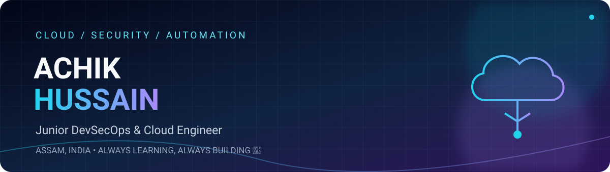

# Hi there, I'm Achik Hussain 👋

### Junior DevOps & Cloud Infrastructure Engineer
📍 **Assam, India** &nbsp;|&nbsp; 🎓 **Diploma in Computer Science & Engineering**

> **"Always Learning, Always Building 🚀"**

  
  &nbsp;
  
  &nbsp;
  
  &nbsp;
  

---

### 👨‍💻 About Me

I am a **Junior DevOps & Cloud Infrastructure Engineer** with a **Diploma in Computer Science & Engineering** from **Assam, India**.

My technical focus centers on provisioning scalable cloud infrastructure using **Microsoft Azure** and **Terraform (Infrastructure as Code)**, while building automated **CI/CD pipelines with Azure DevOps and GitHub Actions**.

I believe in automating repeatable tasks, maintaining infrastructure as version-controlled code, and continuously strengthening my skills through hands-on laboratory projects.

---

### 🛠️ Technical Skills

| Category | Technologies & Tools |
| :--- | :--- |
| **Cloud Platform** | Microsoft Azure (VNets, Subnets, NSGs, Storage Accounts, Managed Identities) |
| **Infrastructure as Code (IaC)** | Terraform (Modules, Remote State, Azure Blob Backend) |
| **CI/CD & Delivery** | Azure DevOps (YAML Pipelines), GitHub Actions |
| **Version Control** | Git, GitHub, Azure Repos |
| **Operating Systems & Scripting** | Linux (Ubuntu, RHEL), Bash Scripting, PowerShell, Python |
| **Quality & Cost Tools** | TFLint, Checkov, Gitleaks, Infracost |

---

### 🚀 Featured Projects

#### ☁️ 1. Azure Infrastructure Automation with Terraform
- Built modular Terraform configurations to provision Azure Virtual Networks, Subnets, and Network Security Groups (NSGs).
- Configured a private Azure Blob Storage backend with state lease locking to ensure safe, team-based deployments.
- Structured code into reusable modules to deploy isolated development and test environments.

#### 🔁 2. Multi-Stage CI/CD Pipelines (Azure DevOps & GitHub Actions)
- Created multi-stage YAML pipelines to validate infrastructure code prior to merging pull requests.
- Integrated automated formatting (`terraform fmt`), syntax validation (`terraform validate`), and plan generation.
- Enforced branch policies and approval gates before deploying changes to live cloud resources.

#### 🔐 3. Pre-Flight IaC Security & Cost Visibility
- Integrated `Gitleaks` into repository workflows to catch accidentally exposed secrets and API keys.
- Utilized `Checkov` to scan Terraform code for security misconfigurations and best practices.
- Implemented `Infracost` in pull requests to calculate estimated monthly cloud expenditure before applying changes.

#### 🐧 4. Linux & Cloud Automation Scripting
- Authored Bash and PowerShell automation scripts for routine cloud operational tasks.
- Automated log rotation, system health checks, and Azure CLI resource queries.

---

### 📚 Currently Learning & Exploring

- 🌐 **Advanced Azure Networking:** Hub-and-Spoke topologies, VNet peering, and Azure Firewall rules.
- 🏗️ **Terraform Best Practices:** Complex dynamic blocks, module testing, and automated drift detection.
- 📊 **Cloud Monitoring:** Gaining deeper experience with Azure Monitor, Log Analytics, and KQL queries.
- 🚀 **Pipeline Reliability:** Implementing deployment environments, rollback strategies, and safe release patterns.

---

### 📊 GitHub Activity

  

<picture>
  <source media="(prefers-color-scheme: dark)" srcset="https://raw.githubusercontent.com/achikhussain12/achikhussain12/output/github-contribution-grid-snake-dark.svg" />
  <source media="(prefers-color-scheme: light)" srcset="https://raw.githubusercontent.com/achikhussain12/achikhussain12/output/github-contribution-grid-snake.svg" />
  
</picture>

---

### 📬 Contact & Connect

- 💼 **LinkedIn:** [linkedin.com/in/achik-hussain](https://www.linkedin.com/in/achik-hussain)
- ✉️ **Email:** [hussainachik456@gmail.com](mailto:hussainachik456@gmail.com)
- 📱 **Mobile / WhatsApp:** [+91 8724872091](tel:+918724872091)
- 🐙 **GitHub:** [github.com/achikhussain12](https://github.com/achikhussain12)
- 📍 **Location:** Assam, India

   
  <i>"Always Learning, Always Building 🚀"</i>

