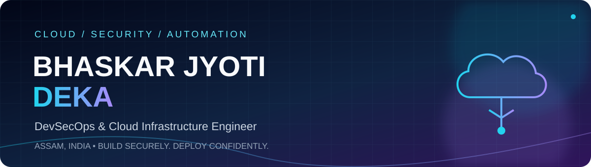
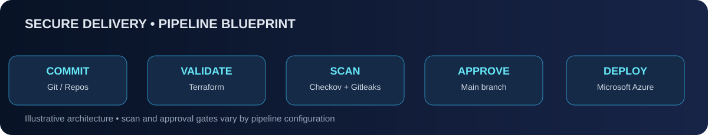

&#x20;\

\

# Achik Hussain

### DevOps & Cloud Infrastructure Engineer

**Azure Cloud | Terraform | Infrastructure as Code | Secure CI/CD**

Assam, India · Diploma in Computer Science & Engineering

*Always Learning, Always Building.*

Automating Infrastructure • Improving Cloud Security • Building Scalable Solutions

\<a href="[https://github.com/achikhussain12](https://github.com/achikhussain12)">   \ \</a> \<a href="[https://www.linkedin.com/in/achik-hussain/](https://www.linkedin.com/in/achik-hussain/)">   \ \</a> \<a href="mailto\:hussainachik456\@gmail.com">   \ \</a>

\

---

## 👨‍💻 Professional Profile

I am a **DevOps and Cloud Infrastructure Engineer** focused on Microsoft Azure, Infrastructure as Code (IaC), cloud infrastructure automation and secure CI/CD practices.

My technical interests include designing and managing cloud infrastructure using Terraform, developing reusable infrastructure modules, implementing Azure Landing Zone concepts, and automating infrastructure workflows using GitHub Actions and YAML pipelines.

I focus on building practical, maintainable and security-conscious infrastructure solutions while continuously improving my knowledge of cloud engineering and DevSecOps practices.

**Core Focus Areas**

- ☁️ Microsoft Azure Cloud Infrastructure
- 🏗️ Azure Landing Zone Architecture
- ⚙️ Terraform & Infrastructure as Code (IaC)
- 📦 Reusable Terraform Modules
- 🔄 Git & GitHub Version Control
- 🚀 GitHub Actions & YAML-based CI/CD
- 🔐 DevSecOps & Infrastructure Security
- 📊 Cloud Governance and Infrastructure Management

> My approach: Automate infrastructure, standardize deployments, and integrate security into the development lifecycle.

---

## 🛠️ Technical Skills

### ☁️ Cloud & Infrastructure

\
 \ \ \ \

### ⚙️ Infrastructure as Code

\
 \ \ \ \

### 🔄 Version Control & CI/CD

\
 \ \ \ \ \

### 🔐 DevSecOps & Security Automation

\
 \ \ \ \ \

*Security tools above represent areas of focus; individual implementations should be documented in the relevant repositories.*

---

## 🏗️ Terraform & Azure Infrastructure Knowledge

| Category                | Technologies / Concepts                        |
| ----------------------- | ---------------------------------------------- |
| Cloud Platform          | Microsoft Azure                                |
| Infrastructure as Code  | Terraform                                      |
| Terraform Fundamentals  | Providers, Resources, Data Sources             |
| Variables & Expressions | Variables, Locals, Maps, Objects               |
| Meta-Arguments          | `for_each`, `count`, `lifecycle`, `depends_on` |
| State Management        | Remote State, Azure Storage Backend            |
| Module Development      | Reusable Parent & Child Modules                |
| Azure Networking        | Virtual Networks, Subnets, Network Interfaces  |
| Azure Compute           | Virtual Machines, VM Scale Sets                |
| Azure Services          | Resource Groups, Storage Accounts, Key Vault   |
| Cloud Architecture      | Azure Landing Zone Concepts                    |
| CI/CD Automation        | YAML Pipelines, GitHub Actions                 |

---

## ⚙️ DevOps & CI/CD Automation

\

\

\

**Automation and workflow focus:**

- Terraform formatting and configuration validation.
- Infrastructure provisioning workflows.
- Git and GitHub-based version control.
- YAML pipeline development and automation.
- GitHub Actions workflow configuration.
- Automated Terraform planning.
- Infrastructure security scanning and validation.
- Version-controlled infrastructure changes.

---

## 📂 Featured Projects

### 01. Terraform Cloud Infrastructure

Azure cloud infrastructure management using Terraform, with a focus on infrastructure organization and automation.

### 02. Terraform Azure Modules

Terraform module development focused on reusable and organized Azure infrastructure components.

### 03. Terraform Azure Landing Zone

Exploring Azure Landing Zone architecture and Terraform-based infrastructure organization.

### 04. Parent & Child Terraform Modules

Practical exploration of parent-child module structures and reusable Terraform configurations.

---

## 🐍 GitHub Contribution Activity

\

\

\

---

## 📊 GitHub Statistics

\

\

\

\

\

---

## 🎯 Continuous Learning & Development

- Advanced Terraform and reusable module development.
- Microsoft Azure infrastructure architecture.
- Azure Landing Zone design concepts.
- GitHub Actions and YAML CI/CD automation.
- DevSecOps and infrastructure security practices.
- Cloud governance and security controls.
- Infrastructure automation and deployment standardization.

---

## 🤝 Let's Connect

\

### Open to learning, collaboration and professional opportunities.

**Achik Hussain**
DevOps & Cloud Infrastructure Engineer

Assam, India

\<a href="mailto\:hussainachik456\@gmail.com">Email\</a> ·
\<a href="[https://www.linkedin.com/in/achik-hussain/](https://www.linkedin.com/in/achik-hussain/)">LinkedIn\</a> ·
\<a href="[https://github.com/achikhussain12](https://github.com/achikhussain12)">GitHub\</a>

\

---

\

**Always Learning. Always Building. Always Automating.**

\

---

### 💙 ALWAYS LEARNING, ALWAYS BUILDING 🚀

**AUTOMATE EVERYTHING. SECURE EVERYTHING. BUILD EVERYTHING.**

